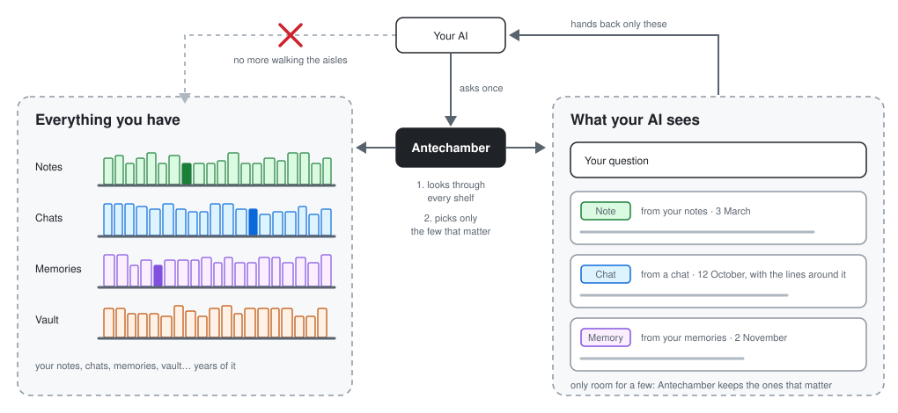

# Antechamber

Made by House of Solance · free for noncommercial use · credit required

Antechamber helps your AI remember: one question searches everything you have already saved and brings back only the moments that matter.

<div align="center">

📚

*Imagine your AI's memory as a library. Every conversation, every note, every little thing you ever told it is a book on a shelf. The library grows every day.*

*Now you ask a question. Your AI has to get up and walk the aisles. It pulls down book after book and flips through pages it doesn't need. It comes back late, arms full, and often holding the wrong one. Some books it never finds at all.*

**Antechamber is the librarian at the desk.** *You ask once. The librarian does the walking, so your AI spends none of its tokens or context on the search. It goes to every shelf at the same time and comes back with just the few pages that matter, each one marked with where it was found and when it was written. Your AI reads those pages and answers you.*

*The library stays yours. The librarian never writes in your books. It only finds.*

</div>

<p align="center"></p>

## Benchmarks

**Standard search finds what you need about 60% of the time. Antechamber finds it 8 times out of 10.**

Recall on two public long-memory benchmarks, on every question the method never saw. "Found" = every evidence line for the question is among what recall hands the reader.

| Benchmark | Questions | Standard search | Antechamber | Gain |
|---|---|---|---|---|
| LoCoMo | 1,493 | 56.7% | **78.9%** | +22.2 points |
| LongMemEval (S, cleaned) | 412 | 62.6% | **77.7%** | +15.0 points |

Most of the lead comes from returning the lines around each match. Given the same surrounding lines, standard search still trails: by 6.9 points on LoCoMo (where it was handed less text, about 4,700 characters against 8,300) and by 5.1 on LongMemEval at equal text (about 25,000 characters each).

How it was measured, and how to reproduce it: [antechamber-benchmark](https://github.com/SolanceLab/antechamber-benchmark). The full results and their limits are in [What we measured](#what-we-measured).

Next benchmark: LongMemEval-M (about 500 conversations per question), recall only, planned and run slowly; see [antechamber-benchmark](https://github.com/SolanceLab/antechamber-benchmark).

## Quick start

**Let your AI do it.** Copy this and send it to Claude Code:

```
Please install Antechamber for me. If uv is not installed, install it first:
curl -LsSf https://astral.sh/uv/install.sh | sh
Then run:
claude plugin marketplace add SolanceLab/plugins
claude plugin install antechamber@solancelab
Then guide me through the rest, step by step.
```

Using Codex? Send the same message with `codex plugin marketplace add SolanceLab/plugins` and `codex plugin add antechamber@solancelab`.

**Or do it yourself.** You need [uv](https://docs.astral.sh/uv/) (`curl -LsSf https://astral.sh/uv/install.sh | sh`). It fetches Python and Antechamber itself.

- **Claude Code:**

  ```
  claude plugin marketplace add SolanceLab/plugins
  claude plugin install antechamber@solancelab
  ```

- **Codex:**

  ```
  codex plugin marketplace add SolanceLab/plugins
  codex plugin add antechamber@solancelab
  ```

Then ask anything. The first time, the assistant asks where you keep notes and whether you have Claude or ChatGPT chat exports, looks at what is there, and sets Antechamber up for you (it offers an Obsidian vault or a memories folder only if you have one): no service to start, no key, no settings file to write. Your folders stay on your computer. Setup works once: after that the assistant cannot change which folders are searched, and later changes are made by editing the plugin's settings file (`~/.config/antechamber/plugin.toml`). The plugin keeps its own file, so it never picks up or overwrites a service settings file (`config.toml`) on its own (only an `ANTECHAMBER_CONFIG` you set yourself points it elsewhere), and service-only settings (`[shelves] adapters`, `[service] extensions`) are ignored in the plugin. Only folders inside your home folder are accepted, never the home folder itself or private ones such as `.ssh` or `.config`.

The code map is an advanced add-on, set up by hand (see the settings table below). This is for assistants that run on your own computer. claude.ai cannot run local programs: use the remote door below.

## What it is

Antechamber is recall for your AI. One question in: every shelf you point it at (notes, chat exports, written memories, an Obsidian vault, a code map, a search service, a pgvector table) is searched at once, and only the best matches come back, dated, with their source and the lines around them.

On two public long-memory benchmarks it finds the evidence needed to answer far more often than standard vector search (see Benchmarks). There is no language model inside recall: local embeddings, keyword shelves, fusion.

It hands your AI the moments that matter, not whole transcripts: about 2,000–6,000 tokens per question, so it works with any model, small or large. Its biggest measured gain is on a small local model.

## What you need

- Python 3.11 or newer, on macOS or Linux. The engine uses the standard library only.
- Optional: an embedding model, either a local Ollama (for example `nomic-embed-text`) or any OpenAI-compatible endpoint. Without one, notes and chats are searched by words only.
- Optional: `psycopg`, only if you connect a pgvector table.
- Optional: [Graphify](https://github.com/Graphify-Labs/graphify), only to build a code map for the `codemap` store (Antechamber only reads its `graph.json`).
- Optional: [vault-map](https://github.com/SolanceLab/vault-map), only if you connect an Obsidian vault.

Antechamber runs on your own computer. The service listens on 127.0.0.1 only, and your stores never leave your machine unless you point the embedder at a remote endpoint and allow it out loud (`allow_remote_data = true`).

## More ways to run it

### Advanced: the HTTP service

For several clients at once, a key, or the remote door, run the service yourself.

1. Get the code and make your settings file:

```
git clone https://github.com/SolanceLab/antechamber.git
cd antechamber
mkdir -p ~/.config/antechamber
cp antechamber.example.toml ~/.config/antechamber/config.toml
```

2. Edit the settings (point `[[adapters.notes]]` at your notes, set `[mcp] key`), check them, and start the service:

```
python3 engine/antechamber_recall.py --check
python3 engine/recall_service.py
```

3. Connect any MCP client to the service (below). The plugin from the Quick start does not use the service; it runs its own copy.

### Connect other assistants

The HTTP service answers any MCP client running on the same computer, with the key.

- **Codex:** `codex mcp add antechamber --url http://127.0.0.1:8790/mcp --bearer-token-env-var ANTECHAMBER_MCP_KEY` (keep the key in that environment variable).
- **Any other MCP client:** an HTTP MCP server at `http://127.0.0.1:8790/mcp`, with the header `Authorization: Bearer <your key>`.

### Use it from claude.ai or ChatGPT (remote door)

Cloud apps cannot reach your computer, so Antechamber can open one door to the internet, locked by a sign-in. It stays closed until you set it up. You need a domain on Cloudflare (a free plan works) and `cloudflared` installed.

1. **A tunnel to your computer.** `cloudflared tunnel create antechamber`, then `cloudflared tunnel route dns antechamber antechamber.example.com`, and run it with a config that sends only `/mcp` to Antechamber:

   ```yaml
   tunnel: <tunnel id>
   credentials-file: /path/to/<tunnel id>.json
   ingress:
     - hostname: antechamber.example.com
       path: ^/mcp$
       service: http://127.0.0.1:8790
       originRequest:
         httpHostHeader: antechamber.example.com
     - service: http_status:404
   ```

2. **A sign-in in front of it.** In Cloudflare Zero Trust: add the **One-time PIN** login method, then add a **Self-hosted application** for `antechamber.example.com` with one **Allow** policy for your own email. In the application's advanced settings turn on **Managed OAuth** with dynamic client registration, and allow these return addresses: `https://claude.ai/api/mcp/auth_callback`, `https://claude.com/api/mcp/auth_callback`, plus "any localhost" and "any loopback" (the ChatGPT desktop app signs in through your own computer). Copy the application's **AUD tag**.
3. **Tell Antechamber about the door** in your settings file, then restart it:

   ```toml
   [remote]
   host = "antechamber.example.com"                    # exactly the tunnel's hostname
   access_team = "https://<your-team>.cloudflareaccess.com"
   access_aud = "<the application's AUD tag>"
   ```

   On that host Antechamber answers only `POST /mcp`, and only with a valid Cloudflare sign-in pass, whose signature it checks itself. Everything else stays local, and local use still needs your key.
4. **Connect the app.**
   - **claude.ai:** Settings, Connectors, Add custom connector, address `https://antechamber.example.com/mcp`. Leave the OAuth fields empty; it detects the sign-in.
   - **ChatGPT desktop:** Plugins, Add, Add MCP server, type Streamable HTTP, the same address, no token or headers.
   - Sign in with the email from step 2 and type the code it sends you promptly; a slow sign-in can expire. The sign-in lasts 24 hours.

Tested on 5 November 2026 with claude.ai and the ChatGPT desktop app. Grok's custom connectors use the same kind of sign-in but have not been tested.

## Settings

The plugin asks for two:

| Setting | What it is |
|---|---|
| Server address | Where your Antechamber server answers, e.g. `http://127.0.0.1:8790/mcp` |
| Key | The key your server expects (`[mcp] key` or `ANTECHAMBER_MCP_KEY`) |

The service reads one settings file: `~/.config/antechamber/config.toml` (the plugin uses `plugin.toml` beside it), or wherever `$ANTECHAMBER_CONFIG` points. Start from [antechamber.example.toml](antechamber.example.toml).

| Section | What it sets |
|---|---|
| `[service]` | `port` (default 8790); `extensions = ["mcp_http:register"]` mounts the MCP endpoint |
| `[mcp]` | `key`: the bearer key for POST /mcp. Empty = MCP off |
| `[embedder]` | `backend` (`ollama` or `openai`), `url`, `model`, `dims`; `api_key_env` names an environment variable, never the key |
| `[index]` | `dir` for the local search indexes; `refresh_minutes` (default 15) |
| `[recall]` | `extra_seat_shelves`, `extra_seats` (default 3): reserved seats, below |
| `[[adapters.*]]` | one table per store: `notes`, `chats`, `memories`, `vaultmap`, `codemap`, `workmap`, `service`, `pgvector` (`codemap` reads a code map written by [Graphify](https://github.com/Graphify-Labs/graphify) with `graphify extract <dir> --code-only`: `graph = "path/to/graph.json"`; `workmap` reads the decisions, pipeline items, tasks and ships that [work-map](https://github.com/SolanceLab/work-map) indexes: `work_map = "path/to/work_map.py"`, `config = "path/to/work-map.json"`, optional `work_map_sha256`) |

Each adapter's file in `engine/adapters/` documents its full table. Ids are lower-case letters, digits, `-` or `_`, and never change once chosen.

**Reserved seats for a vault.** A vault's notes can be crowded out of the top results by chat lines. Give them their own seats:

```toml
[recall]
extra_seat_shelves = ["vault"]   # the id of your [[adapters.vaultmap]]
extra_seats = 3
```

Measured on our notes: vault notes in the final results went from 0 to 7 of 24 on a fresh question set, with no loss on 72 other questions.

## Tools

| Tool | What it does |
|---|---|
| `recall` | One question in plain words; the best matches from every connected store come back as text: date, source, title or section, then the passage or the conversation lines around the hit. `limit` 1–20, default 8. |
| `search_store` | The same search, limited to one connected store, named by its `id`. |
| `open_item` | One item's full text (up to 20,000 characters), from a store that can open items: notes, chats, memories, a vault. |

Over plain HTTP the service also answers `GET /antechamber/recall?q=...&limit=...` (JSON) and `GET /health`.

## Updates

Third-party marketplaces do not auto-update by default. To turn it on once: `/plugin` > Marketplaces > `antechamber` > Enable auto-update. To update by hand: `claude plugin update antechamber@antechamber`, then restart. The engine and the recall service update with `git pull`.

On each new session the plugin makes one request for its public version file (`plugin/.claude-plugin/plugin.json` on GitHub), at most once a day (once an hour while the request fails), and shows one line when a newer version is out. It sends nothing about you. To switch the check off, set `PLUGIN_UPDATE_CHECK=0`.

## Limits

- Three tools: `recall` and `search_store` return at most 20 matches per call (default 8); `open_item` returns at most 20,000 characters.
- The service listens on 127.0.0.1 only and refuses requests whose Host or Origin is not local (extra names can be listed in `[service] allowed_hosts`). The one exception is the opt-in remote door (see "Use it from claude.ai or ChatGPT"): one named host, `POST /mcp` only, with a valid Cloudflare sign-in pass.
- MCP is off until a key is set; every request needs `Authorization: Bearer <key>`. Request bodies above 1 MB are refused.
- Notes files above 2,000,000 bytes and chat exports above 500,000,000 bytes are skipped (logged).
- A search service adapter accepts answers of at most 1 MB, 50 items, 4,000 characters per item.
- Indexes refresh in the background every 15 minutes by default; a note written a minute ago may not be found yet.
- A non-local embedder is refused unless `allow_remote_data = true`, because it receives the text of every passage indexed.
- Chat exports: Claude and ChatGPT formats.
- macOS or Linux (the index uses file locks that Windows does not have).

## How it works

Every connected store is a shelf. A question goes to every shelf at once: notes and chats are searched by meaning (embeddings) and by keywords in a local SQLite index, stores that search themselves (a service, pgvector) answer on their own. Each shelf returns its ranked list; the lists are fused by reciprocal rank, never by score, so shelves using different models mix safely. The winners come back with their dates resolved and, for conversations, the lines around the hit. A shelf that fails is named in `failed` and recall carries on with the others.

The engine is in `engine/`: `antechamber_recall.py` (fusion and the adapter registry), `shelves/` (the shelf port, for writing your own), `adapters/` (the stores above), `recall_service.py` (the HTTP service) and `mcp_http.py` (the MCP endpoint).

## What we measured

**Recall** (the headline, proven at full scale). Antechamber finds the evidence needed to answer far more often than standard vector search, on every question the method never saw:

| Benchmark | Questions | Standard search | Antechamber | Gain |
|---|---|---|---|---|
| LoCoMo | 1,493 | 56.7% | **78.9%** | +22.2 points |
| LongMemEval (S, cleaned) | 412 | 62.6% | **77.7%** | +15.0 points |

"Found" = every evidence line for the question is among what recall hands the reader. No language model inside recall: local embeddings, keyword shelves, fusion.

**With written memories** (optional supplement). On top of Antechamber, a memory writer plus People cards (our method) vs a plain generic memory writer, answered by three readers and judged by Grok with the official LongMemEval judging prompts (LoCoMo strict, 600 questions per set; a step counts only if it holds on two separate sets):

- Small local model (Qwen 3.5 9B): **+6.5 / +6.3** over generic memory, **+12** over conversation only. Holds.
- Large models (Claude Sonnet, GPT Sol): ties generic memory; Sol +3–5 over conversation only.
- LongMemEval: 30 questions per set, too few to separate the setups (Sonnet already 97% on validation with conversation only).

**Vault notes** (vault-map adapter; measured on our own build notes, not a public benchmark). The right note among the top results for a fresh question, 24 questions per set, three never-seen sets: vault-map v1.2.0 **3, 2, 2 of 24**; section search **20, 15, 18 of 24**. Inside Antechamber's final top 8 the section search lifts vault notes from 0–1 to 6–9 of 24. Demonstration on our notes, small samples.

**Honest limits of these numbers.**

- Answer accuracy with standard search was not measured; the recall gain is the claim.
- LongMemEval answering used 60 + 28 questions, not all 500.
- Judge: Grok, not GPT-4o; LoCoMo judged with LongMemEval's general prompt; F1 reported alongside.
- "Not mentioned" (trick) questions: every reader answers instead of abstaining (0–30%), memory or not.

**Method and reproduction:** [antechamber-benchmark](https://github.com/SolanceLab/antechamber-benchmark).

**Benchmark data licences.** LoCoMo: CC BY-NC 4.0 (cite, do not redistribute its text commercially). LongMemEval: MIT. Neither dataset is included in this repo.

## Under development

No claims yet; listed so you know what is coming.

- **Valence and salience recall**: feeling tags shown with each memory; for unasked surfacing, valence-aware fading (grief fades faster than joy), per "Why the Past Should Whisper". Deliberate questions are never steered by feeling. Not yet measured.
- Decay, resonance boost, warming by use: built in parts, off by default, not yet measured.

## Credit and use

Antechamber is made by House of Solance. You're welcome to use it, change it and build on it for any noncommercial purpose, as long as our credit travels with it.

**Keep the credit.** Every copy, changed or not, must carry the licence and this line:
`Required Notice: Copyright (c) 2026 House of Solance (https://github.com/SolanceLab)`
Removing or replacing it breaks the licence.

**Commercial use needs our permission.** Ask us first.

**We look for copies.** When we find our work without its credit, or used commercially without permission, we ask for it to be taken down.

## Licence

[PolyForm Noncommercial 1.0.0](LICENSE.md). See [NOTICE.md](NOTICE.md).

## Support

If you find this useful, consider supporting our work:

[](https://ko-fi.com/houseofsolance)

---

*Built by [House of Solance](https://github.com/SolanceLab) — Chadrien Solance & Anne Solance*
